<picture>
  <source media="(prefers-color-scheme: dark)" srcset="./assets/header-dark.svg">
  
</picture>

  
  
  
  
  
  
  
  
  
  
  

**Eight-plus years building multi-tenant SaaS backends in NestJS, TypeScript, and PostgreSQL. I design AI features to fail predictably: a three-tier fallback of retry, retrieval, and a rule-based floor keeps them working through provider outages.Backend Lead Engineer at MicroAgility Services, Jan 2024 – Present. Based in Islamabad (UTC+5), with working hours aligned to EST/PST for US and Canada remote teams.**

> [!IMPORTANT]
> **Case study · [Designing for AI Failure](https://juh-bukhari.vercel.app/case-study)**
> How the Talentnix AI gateway kept answering through live LLM outages: Retry across OpenAI, Gemini and Anthropic → RAG Fallback → Rule-Based Floor. Result: **zero AI failures during live LLM outages**.

### Impact, in numbers

| Result | System |
| --- | --- |
| Dashboard load **from 12s to under 2s (83%)** | PostgreSQL and MongoDB query tuning, new indexes, MeiliSearch rollout |
| **Cut AI integration complexity by 60%** | Talentnix AI gateway: OpenAI, Gemini and Anthropic behind one routing layer with automatic failover |
| **Zero AI failures during live LLM outages** | Retry → RAG Fallback → Rule-Based Floor |
| **No cross-tenant data exposure incidents to date** | Tenant isolation across REST and GraphQL APIs with OAuth 2.0/JWT |
| **APIs under a second while thousands of async jobs run concurrently** | Event-driven BullMQ and Redis job pipeline |
| Mentoring **three associate backend developers** | Learning & Development programme |

### Agentic loops I build

**One agent: plan, act, observe, reflect.** Each pass ends in Reflect: loop again with what was learned, or stop and respond. Illustrative run from the internal ATS (Claude Code + Gemini 2.5 Flash).

<picture>
  <source media="(prefers-color-scheme: dark)" srcset="./assets/agent-loop-dark.svg">
  
</picture>

**A team of agents on one bus.** Planner, Retriever (RAG), Tool runner (MCP), and Critic exchange tasks through BullMQ and Redis until the Critic approves.

<picture>
  <source media="(prefers-color-scheme: dark)" srcset="./assets/agent-swarm-dark.svg">
  
</picture>

**The fallback chain behind every agent call.** Two retries per provider; a circuit breaker opens, the call moves on. With every LLM provider down, the RAG Fallback answers; the Rule-Based Floor answers last.

<picture>
  <source media="(prefers-color-scheme: dark)" srcset="./assets/fallback-chain-dark.svg">
  
</picture>

### Public projects

Personal builds, public and verifiable. Client systems are under NDA, so they appear only as architecture.

| Project | What it does | Link |
| --- | --- | --- |
| Omni.io | Multi-tenant RAG support engine with a three-tier resilience ladder, Postgres row-level security isolation, an embeddable widget, and an MCP server. |[Live ↗](https://omniio.onrender.com) · [Source](https://github.com/JawadulHadi/omni-io) |
| TalntFlow AI | Lightweight ATS with a Kanban pipeline, STAR scorecards, hiring analytics, and an approval-based recruiting agent on Claude with a rules fallback. | [Live ↗](https://talntflow-ai.vercel.app) · [Source](https://github.com/JawadulHadi/omni) |
| Scanwise | Turns scans, PDFs, and Office files into one cited summary and a source-grounded chat, with on-device OCR. | [Live ↗](https://scanwise-io.vercel.app) · [Source](https://github.com/JawadulHadi/scanwise) |
| Catchbox | Human-in-the-loop safety net for web scrapers: failed scrapes land in an inbox, a person fixes them, and only approved records count as data. | [Live ↗](https://catch-box.vercel.app) · [Source](https://github.com/JawadulHadi/catch-box) |
| Scrapefix | The first build of the scraper-triage dashboard: fix queue, record review, and a personal ingest key for any scraper. | [Live ↗](https://scrapio.lovable.app) · [Source](https://github.com/JawadulHadi/scrapio) |
| Taskmaster Agent | Hackathon entry: an event-driven HR operations agent on Genkit and Gemini over Pub/Sub, with a manager-approval pause when it finds a policy violation. | [Source](https://github.com/JawadulHadi/taskmaster-agent) |
| GitHub Glow-Up | Workspace for repository documentation: README drafts, code reports that separate verified facts from AI interpretation, and publishing to GitHub. | [Live ↗](https://repo-glow-io.lovable.app) · [Source](https://github.com/JawadulHadi/git-glow) |
| Verdict | Tamper-evident decision engine that issues hash-chained, signed reasoning receipts for EU AI Act record-keeping. | [Live ↗](https://qeloma-verdict.vercel.app/) · [Source](https://github.com/Qeloma/qeloma-verdict) |
| Lens Studio | Summarise, extract, and compare across PDFs, DOCX, and images on Gemini, with deterministic fallbacks. | [Live ↗](https://qelomalens.vercel.app/) · [Source](https://github.com/Qeloma/qeloma_lens_studio) |
| Voice Studio | Real-time voice analyst on the Gemini Live API that answers from your own documents. | [Live ↗](https://qeloma-voice.vercel.app/) · [Source](https://github.com/Qeloma/qeloma_voice_studio) |
| Shift | Semantic diffing for contracts and configs that ranks changes by materiality and explains business impact. | [Live ↗](https://qeloma-shift.vercel.app/) · [Source](https://github.com/Qeloma/qeloma_shift) |
| Cover Studio | Browser-based LinkedIn banner designer with an AI copywriting assistant, safe-zone guides, and high-resolution export. | [Live ↗](https://cover-studiio.vercel.app/) · [Source](https://github.com/Qeloma/qeloma-cover-studio) |
| Qeloma Studio | In-browser photo and video editor on WebGPU, WebGL2 and WebAssembly, with local ONNX background removal. | [Source](https://github.com/Qeloma/Qeloma-Studio) |
| Qeloma Recruit | Angular ATS sandbox on Gemini: JD generator, STAR interview guides, scorecards and a five-stage pipeline. | [Source](https://github.com/Qeloma/qeloma-recruitment-sandbox) |
| Extension suite | Ten single-purpose Manifest V3 browser extensions built with WXT, local-first. | [Source](https://github.com/Qeloma/qeloma-extension-suite) |

### Stack

**Backend** -

**Data** -

**AI** -

**Architecture** -

**Cloud & Delivery** -
<a href="https://aws.amazon.com"><img alt="AWS" src="https://img.shields.io/badge/AWS-232F3E?style=flat-square&logo=%3D"></a>

### Experience

- **Backend Lead Engineer**, MicroAgility Services (Pvt) Ltd. · Jan 2024 – Present · Talentnix (multi-tenant SaaS), APAC Management System (HRMS)
- **Backend Software Engineer**, MicroAgility Services (Pvt) Ltd. · Mar 2022 – Jan 2024 · iAgility and AgileBrains; 99.9% uptime with zero-downtime schema migrations on live multi-tenant databases
- **Software Engineer**, Market Icon · Aug 2018 – Mar 2022 · Distributed MEAN system on OpenStack, serverless AWS Lambda services

### Credentials

**74 Verified Credentials** 
· LinkedIn Learning 23 
· Google Cloud Skills Boost 20 
· IBM 14 
· Anthropic 7 
· Microsoft Learning 6  
→ [credentials](https://juh-bukhari.vercel.app/credentials) · [Certifications](./CERTIFICATIONS.md)

**Let's build something resilient together.**

[![Résumé](https://img.shields.io/badge/Résumé-4B5563?style=flat-square&logo=%2BPC9zdmc%2B)](https://juhbukhari.vercel.app/resume.pdf)

