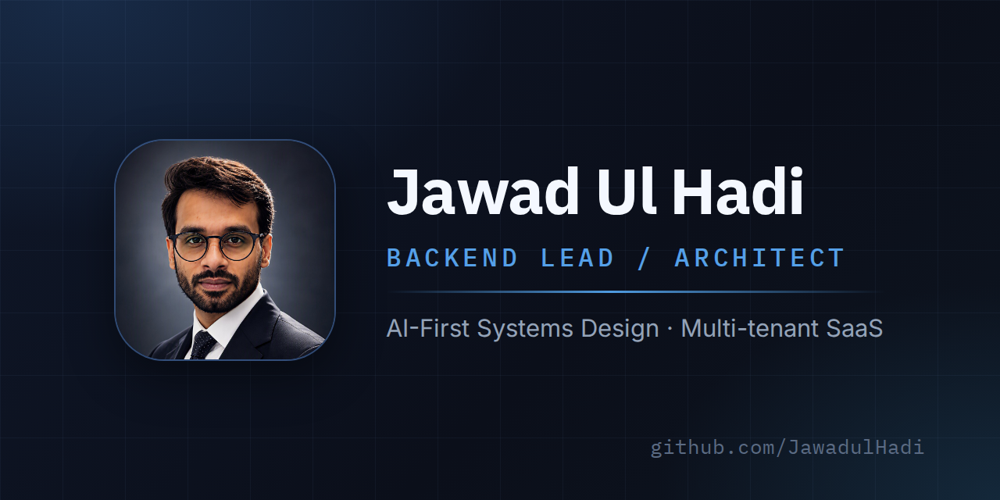
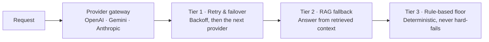

  

**Backend Lead Engineer with 8+ years building distributed systems for multi-tenant SaaS and enterprise products. At MicroAgility I lead backend architecture for Talentnix, a multi-tenant SaaS platform, and the APAC Management System (HRMS). I work mainly in Node.js, NestJS and TypeScript on PostgreSQL, MySQL, MongoDB and Redis, with Python and FastAPI where they fit, and I own architecture from database schema to deployment. My recent focus is production AI: Anthropic-based features, MCP servers, provider-agnostic abstraction layers and RAG pipelines, with retry and fallback patterns that keep failures quiet and contained.**

## Experience

| Role                      | Company                          | Period              | Systems                                                                                 |
| ------------------------- | -------------------------------- | ------------------- | --------------------------------------------------------------------------------------- |
| Backend Lead Engineer     | MicroAgility Services, Islamabad | Jan 2024 – Present  | Talentnix multi-tenant SaaS and AI gateway, APAC Management System (HRMS), internal ATS |
| Backend Software Engineer | MicroAgility Services, Islamabad | Mar 2022 – Jan 2024 | iAgility and AgileBrains hiring platforms on MEAN microservices and GraphQL             |
| Software Engineer         | Market Icon, Rawalpindi          | Aug 2018 – Mar 2022 | Large-scale MEAN system on OpenStack, serverless AWS services, CRM and payment APIs     |

- **12s → under 2s** dashboard response times (83%) through PostgreSQL and MongoDB query tuning, new indexes and a MeiliSearch rollout.
- **Zero cross-tenant data exposure** to date, with tenant isolation enforced across REST and GraphQL APIs using OAuth 2.0/JWT.
- **Sub-second APIs** while thousands of async jobs run concurrently on an event-driven BullMQ and Redis pipeline.
- **99.9% uptime** through zero-downtime schema migrations on live multi-tenant production databases.
- **~40% faster data retrieval** after refactoring REST and GraphQL services that serve thousands of users across tenants.
- **Faster releases** from GitHub Actions CI/CD with automated test gates, plus full Jest unit-test coverage built with GitHub Copilot.
- **Three associate developers** mentored through MicroAgility's Learning & Development program.

> Client systems are under NDA. Architecture is described without business data or endpoints.

## Stack

| Area             | Tools                                                                                                                    |
| ---------------- | ------------------------------------------------------------------------------------------------------------------------ |
| Architecture     | Distributed systems, microservices, event-driven architecture, multi-tenant SaaS, REST and GraphQL API design            |
| Backend          | Node.js, NestJS, TypeScript, Express.js, Python, FastAPI, Django REST Framework, PostgreSQL, MySQL, MongoDB, Redis       |
| Queues & search  | BullMQ, MeiliSearch, query and performance optimisation                                                                  |
| AI systems       | LLM integration (OpenAI, Gemini, Anthropic), RAG pipelines, MCP servers, AI agent workflows, Claude Code, GitHub Copilot |
| Cloud & delivery | AWS (Lambda, API Gateway), GCP, OpenStack, Docker, Kubernetes, GitHub Actions CI/CD, Jest, OAuth 2.0 / JWT               |
| Domains          | Multi-tenant SaaS, HRMS, CRM                                                                                             |

## Services

|    | Service                  | Scope                                                                                                      |
| -- | ------------------------ | ---------------------------------------------------------------------------------------------------------- |
| 01 | Backend architecture     | Multi-tenant SaaS design with tenant isolation, schema strategy and REST or GraphQL API contracts.         |
| 02 | AI platform & resilience | Provider-agnostic LLM layers, RAG pipelines and fallback ladders that keep AI features up through outages. |
| 03 | Performance & scale      | Query and index work, search, and queue-based workloads that keep APIs sub-second under load.              |
| 04 | Technical leadership     | Mentoring and onboarding, architecture and code review, and architecture decision records (ADRs).          |

**Education:** B.S. Computer Science, Government College University, Faisalabad, 2018

**Certifications:** Claude Code in Action (Anthropic) · Containers & Kubernetes Essentials (IBM) · Gen AI: Beyond the Chatbot (Google) · Introduction to Generative AI and Agents (Microsoft) · Certified Django Developer.
[All verified certifications →](./CERTIFICATIONS.md)

### Featured · Designing for AI failure

Talentnix's AI gateway puts one routing layer in front of OpenAI, Gemini and Anthropic, with automatic failover between them. When a provider degrades, requests step down through three tiers instead of surfacing an error. Users have seen zero AI failures during live LLM outages, and the single gateway cut AI integration complexity by 60%.

[Read the full case study →](https://juh-bukhari.vercel.app)

## Projects & open source

Personal builds, public and verifiable.

**Flagship · Chrome extension pack.** Ten Manifest V3 extensions for developer and AI workflows: context extraction for agents, an API interceptor and mock sandbox, a schema and JWT decoder, a prompt workbench with diffing, token and cost estimates, a document scraper, a cross-LLM model switcher, a webhook relay, session isolation and a browser workflow recorder.
`Chrome Extension API · TypeScript · Gemini API · WebSockets · IndexedDB`

**Infrastructure · Idempotent queue spine.** A BullMQ and Redis backbone for OCR extraction, batch email and multi-tenant webhook dispatch, with HMAC signature verification, dead-letter queues and exactly-once processing.
`BullMQ · Redis · NestJS · HMAC`

### The Qeloma suite

| Project      | What it does                                                                                                                       | Link                                         |
| ------------ | ---------------------------------------------------------------------------------------------------------------------------------- | -------------------------------------------- |
| Verdict      | Tamper-evident decision engine that issues reasoning receipts with cryptographic audit trails, built for EU AI Act record-keeping. | [Live ↗](https://qeloma-verdict.vercel.app/) |
| OCR          | Client-side OCR with per-word confidence scores from Tesseract.js, Gemini vision or a hybrid of both.                              | [Live ↗](https://qeloma-ocr.vercel.app/)     |
| Lens Studio  | Summarise, extract and compare across PDFs, DOCX and images, powered by Gemini with rule-based fallbacks.                          | [Live ↗](https://qelomalens.vercel.app/)     |
| Voice Studio | Real-time voice analyst that answers from your own documents through the Gemini Live API.                                          | [Live ↗](https://qeloma-voice.vercel.app/)   |
| Shift        | Semantic diffing for contracts and configs that ranks changes by severity and explains business impact.                            | [Live ↗](https://qeloma-shift.vercel.app/)   |
| Cover Studio | Browser-based LinkedIn banner studio that composes on-brand vector cover art from a short prompt.                                  | [Live ↗](https://cover-studiio.vercel.app/)  |

## Contact

Open to full-time Backend Lead, Solutions Architecture and AI Platform roles: remote, hybrid or on-site, and to relocation with support.

[Résumé (PDF)](./assets/Jawad_Ul_Hadi_Resume.pdf) · [Email](mailto:jawadulhadicc@gmail.com) · [Portfolio](https://juh-bukhari.vercel.app) · [LinkedIn](https://linkedin.com/in/jawad-ul-hadi) · [Stack Overflow](https://stackoverflow.com/users/19086162/jawad-ul-hadi) · [GitLab](https://gitlab.com/JawadulHadi) · [Islamabad, PK](https://maps.google.com/?q=Islamabad,Pakistan)
